# ZaMarket Academy — Affiliate Course

Everything you need to earn as a ZaMarket affiliate: the site, your link, posters, WhatsApp, vehicles, lunch plans and a 30-day plan.

> No salary and no guaranteed earnings. Commission is earned only on completed, qualifying sales.

## Contents

1. Welcome: how ZaMarket works and how you earn (5 lessons)
2. Your affiliate account, step by step (5 lessons)
3. Your link: how credit works (4 lessons)
4. The Promotion Studio: posters, captions and photos (5 lessons)
5. Choosing what to promote and who to (4 lessons)
6. WhatsApp: status, chats, groups and broadcasts (5 lessons)
7. Facebook, TikTok and Instagram (4 lessons)
8. Writing posts and messages that get replies (4 lessons)
9. Conversations: answering, objections and follow-up (5 lessons)
10. ZaMarket Motors: earning from vehicles (5 lessons)
11. Lunch at work: earning every day from lunch plans (4 lessons)
12. Honesty, the law and staying paid (4 lessons)
13. Your numbers: tracking what works (4 lessons)
14. The 30-day plan: from first sale to steady income (5 lessons)

## Module 01: Welcome: how ZaMarket works and how you earn

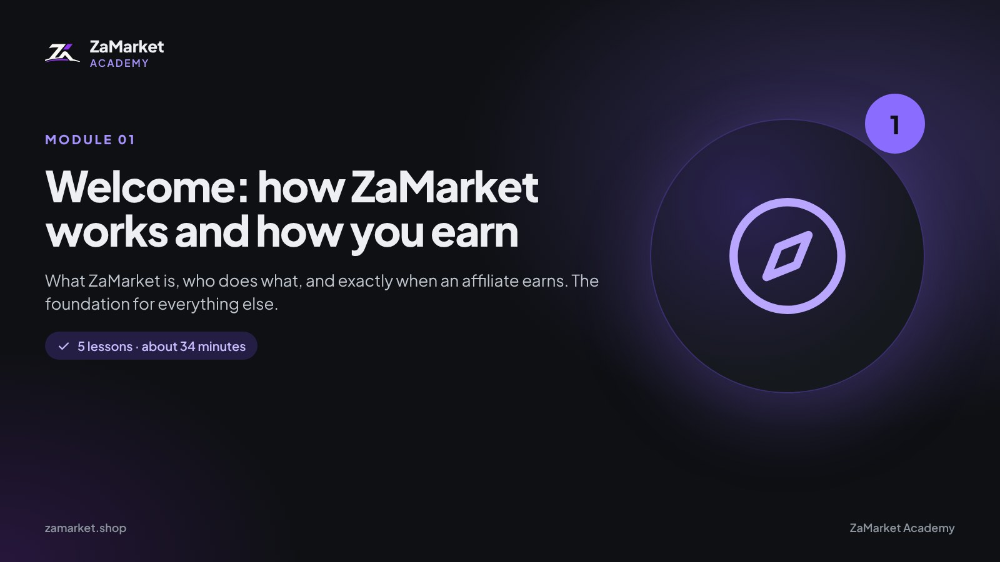

What ZaMarket is, who does what, and exactly when an affiliate earns. The foundation for everything else.

### Lesson 01.01: What ZaMarket is

*About 7 minutes*

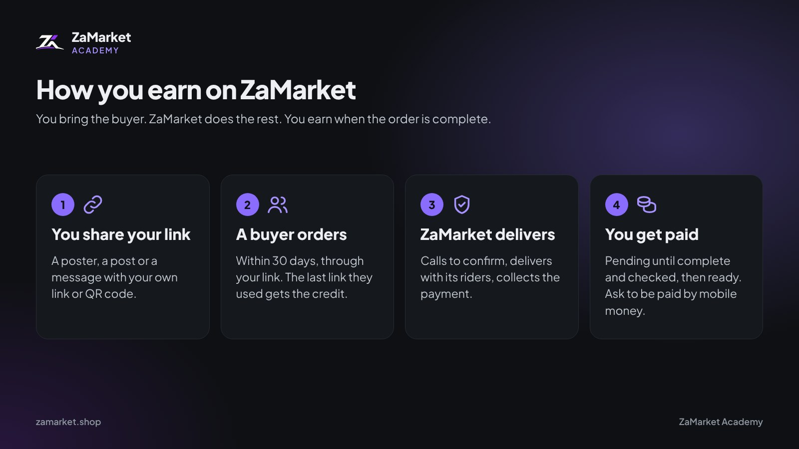

**You will be able to:** Describe ZaMarket in one sentence to a friend and name the three kinds of things it sells.

**Key points**

- Sellers list, ZaMarket runs orders and delivery, you bring buyers
- No stock, no collecting money, no delivering
- Products, lunch plans and vehicles

**Lesson**

- ZaMarket is a Zambian online marketplace at zamarket.shop. Local sellers list their products, and ZaMarket handles the orders, the customer calls, the delivery and the money.
- There are three kinds of listings you will promote: products that are delivered (cakes, kitchen equipment, goods), lunch plans (homemade lunches delivered to workplaces) and vehicles in ZaMarket Motors (cars, pickups and SUVs from owners and dealers we trust).
- You never buy stock, never collect money and never deliver anything. Your job is to bring the right buyer to the right listing, through your own link.
- A simple way to say it: "ZaMarket is where Lusaka sellers list their things, and I help people find what they need there."

**Show it:** Open zamarket.shop on your phone. Show the front page, Today's deals, Motors and one seller's shop. Point out that every product has a photo, a price and an Order or Ask button.

**Your turn:** Write your own one-sentence description of ZaMarket and say it out loud three times until it sounds natural. Then send it to one person you trust and ask if it is clear.

**Check:** What are the three kinds of listings an affiliate can promote on ZaMarket?

> Delivered products, lunch plans, and vehicles in ZaMarket Motors.

*For the trainer:* Keep this short and confident. Many new affiliates over-explain. One clear sentence is enough.

### Lesson 01.02: The four people in every sale

*About 7 minutes*

**You will be able to:** Explain the roles of the seller, ZaMarket, the affiliate and the customer, and what each one is responsible for.

**Lesson**

- The seller makes or owns the product and keeps the listing honest: photos, price, what is included.
- ZaMarket runs the marketplace: it records the order, calls the customer to confirm, arranges delivery with its riders, collects payment and pays sellers and affiliates.
- You, the affiliate, find people who genuinely need the product, share the listing honestly with your link, answer simple questions and follow up politely.
- The customer decides. They are never pressured. If they have a problem, ZaMarket's team handles it; you do not promise refunds or discounts yourself.
- Knowing the roles protects you. If someone asks for something only the seller or ZaMarket can decide (a lower price, a delivery time, a refund), you pass the question to ZaMarket instead of guessing.

**Show it:** Draw four circles on paper: Seller, ZaMarket, Affiliate, Customer. Draw arrows: the product goes from seller to customer through ZaMarket; the link goes from affiliate to customer; the commission goes from ZaMarket to affiliate.

**Your turn:** For each of these questions, write who answers it: "Can I get it tomorrow?", "Is it negotiable?", "What is in the box?", "Can you send me more photos?"

**Check:** A customer asks you for a discount. What do you do?

> Do not promise anything. Tell them you will check, and ask ZaMarket on WhatsApp. Only sellers and ZaMarket decide prices.

*For the trainer:* Emphasise that passing a question on is professional, not weak.

### Lesson 01.03: Exactly when you earn

*About 8 minutes*

**You will be able to:** State the conditions for earning a commission and explain why money appears only after an order is complete.

**Key points**

- Earn on completed orders only
- Vehicles: estimate first, final after the deal closes
- Lunch: every lunch delivered, including re-bookings

**Lesson**

- You earn a commission when a customer you brought, through your link, places an order and that order is completed: delivered, paid and past ZaMarket's check.
- Until then the commission is pending. Orders can be cancelled, refused at the door or returned, and nobody earns on a sale that did not happen.
- The amount for each product is shown to you on the Promote products page. It is a share of ZaMarket's fee, which is why it differs between products. Customers never see it.
- For vehicles you see an estimated reward. The final amount is worked out on the price the buyer actually pays, and it is paid after the deal is closed.
- For lunch plans you earn on every lunch delivered to a customer you brought, every day they eat, including when they book again.

**Show it:** Open My earnings and Commissions. Show the difference between pending and ready. Open one product in Promote products and point to the commission shown for it.

**Your turn:** Pick three products. Write down the commission shown for each, and the price the customer pays. Notice which earn more and why that might be.

**Check:** When does a pending commission become money you can ask to be paid?

> When the order is complete (delivered and paid) and has passed ZaMarket's check. Then it shows as ready to request.

*For the trainer:* Never let anyone describe pending money as earned. This prevents disappointment and disputes.

### Lesson 01.04: What this course will and will not promise

*About 6 minutes*

**You will be able to:** Explain honestly what results depend on and why there are no guaranteed earnings.

**Lesson**

- Affiliate marketing works. People across the world earn steady income by recommending products they believe in. But income depends on effort, consistency, the people you reach and the products you choose.
- There is no salary and no guaranteed amount. Anyone who promises you a fixed income from affiliate work is not telling the truth.
- What this course gives you is a method that has worked for affiliates everywhere, adapted to Zambia: talk to the right people, share useful posts every day, answer fast, follow up, track what works and do more of it.
- Most affiliates who succeed did one thing differently: they kept going for 30 days, even when the first week was quiet.

**Show it:** Share the 30-day plan (Module 14) at a glance so learners see where they are heading.

**Your turn:** Write down why you want to earn as an affiliate and how many hours a week you can honestly give it. Keep this note; you will use it in Module 13.

**Check:** Is a ZaMarket affiliate paid a salary?

> No. Affiliates earn commission on completed sales they brought. There is no salary and no guaranteed income.

*For the trainer:* Set expectations warmly. Honest expectations keep affiliates going longer.

### Lesson 01.05: Halal, lawful and honest: the ZaMarket way

*About 6 minutes*

**You will be able to:** List the principles every ZaMarket affiliate works by.

**Lesson**

- Everything we sell and say must be lawful, honest and halal. We earn from real value: helping a buyer find what they need.
- We never invent reviews, discounts, "only 2 left", fake deadlines or results. If a listing says it, you may repeat it. If it does not, you do not say it.
- We never spam. We message people who know us or who asked, and we post where posting is allowed.
- We say we earn when it matters. A simple line like "I earn a small commission if you buy through my link" builds trust rather than losing it.
- We respect privacy. A buyer's name and number are used only to help them buy, never shared or sold.

**Show it:** Read three example posts aloud. Learners spot which one invents a claim ("best price in Lusaka, only today!").

**Your turn:** Rewrite one exaggerated post so that every claim in it is true and visible on the listing.

**Check:** A seller's listing does not mention a discount. Can you tell a customer there is one?

> No. You only repeat what the listing says. If they want a better price, ask ZaMarket.

*For the trainer:* This lesson is short but non-negotiable. Return to it whenever a learner's post exaggerates.

## Module 02: Your affiliate account, step by step

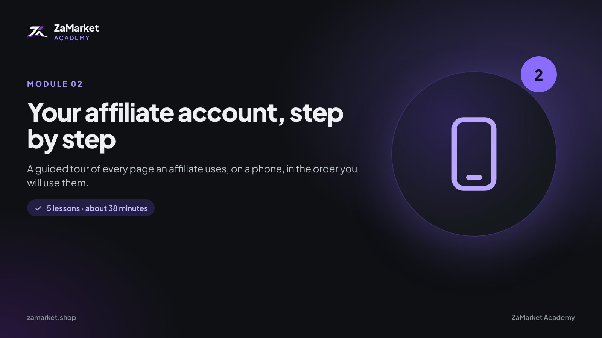

A guided tour of every page an affiliate uses, on a phone, in the order you will use them.

### Lesson 02.01: Signing in and your dashboard

*About 7 minutes*

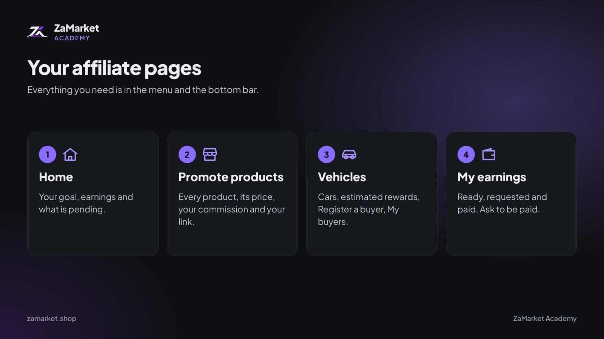

**You will be able to:** Sign in, find your dashboard and read what each part of it tells you.

**Lesson**

- Sign in at zamarket.shop with the Google account you applied with. Your dashboard opens at Sell (the Home tab at the bottom).
- The bottom bar has Home, Promote, Earnings and Academy. More options are in the menu: Promote products, Vehicles, Promotion studio, My earnings, Academy and Commissions.
- Your dashboard shows your monthly goal, what you have earned and what is pending. It is your daily starting point.
- If a page ever says your session expired, sign in again. Nothing is lost.

**Show it:** On a phone, sign in and tap through each item in the bottom bar and the menu, saying in one sentence what each page is for.

**Your turn:** Set a monthly goal on your dashboard that matches the hours you wrote down in Lesson 1.04.

**Check:** Which page do you open to see how much is ready to be paid?

> My earnings.

*For the trainer:* Let learners do this on their own phones, not watch a screen. Muscle memory matters.

### Lesson 02.02: Promote products: finding something to share

*About 8 minutes*

**You will be able to:** Use Promote products to find a listing, read its details and copy your link.

**Lesson**

- Promote products lists everything you can promote, with its photo, price and your commission.
- Open a product before you share it. Read the description, what is included, delivery notes and whether it is made to order. You cannot sell what you do not understand.
- Every product has your personal link. It starts with zamarket.shop/r/ followed by your code and the product name.
- Start with a few products you would genuinely recommend to people you know. Five well-chosen products beat fifty random ones.

**Show it:** Open Promote products, choose one cake and one kitchen item, read both pages fully, and copy the link of each.

**Your turn:** Choose five products for your starting list. For each, write who you know that might need it.

**Check:** What does your personal product link start with?

> zamarket.shop/r/ followed by your affiliate code and the product.

*For the trainer:* Watch for learners picking products only by commission. Steer them to products their contacts need.

### Lesson 02.03: The share button and the poster maker

*About 9 minutes*

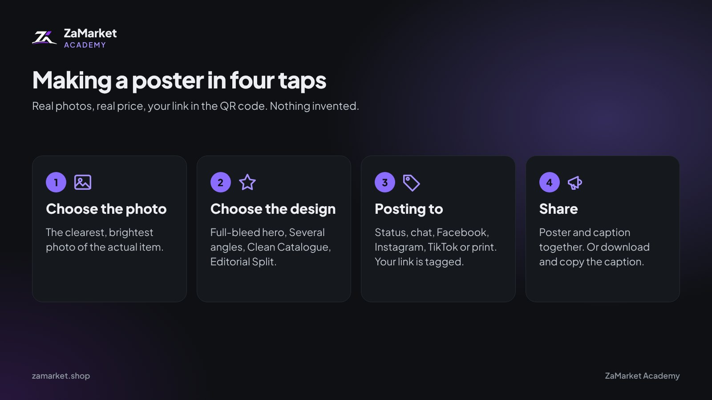

**You will be able to:** Make a branded poster for any product, choose the right design and size, and share it with its caption.

**Lesson**

- On any product, tap Share with your affiliate link (or Make a poster to share on vehicles and lunch plans). A poster is made for you from the product's real photos, name and price, with a QR code that carries your link.
- Choose the photograph to feature, then a design: Full-bleed hero (one strong photo), Several angles (main photo plus others), Clean Catalogue, Editorial Split and others. The star shows the design that suits that product best.
- Posting to: choose where you will post it (WhatsApp status, WhatsApp chat, Facebook, Instagram, TikTok, printing). Your link is tagged with it, so you can later see which platform brings buyers.
- Size: portrait for feeds, story for WhatsApp status and TikTok, square and wide for other places.
- Share poster sends the picture and the caption together. Copy caption and Copy your link are there too.

**Show it:** Make three posters for the same product, one in each of three designs. Compare them on a phone screen at arm's length: which one would you stop scrolling for?

**Your turn:** Make a story-size poster for one of your five products, set Posting to WhatsApp status, and post it on your status today.

**Check:** Why should you set Posting to before sharing?

> Your link is tagged with the platform, so you can see later which platform brought buyers and do more of what works.

*For the trainer:* The poster maker never invents anything. If a poster looks thin, the listing is thin; tell ZaMarket so the seller can add photos.

### Lesson 02.04: Vehicles and the Promotion studio

*About 7 minutes*

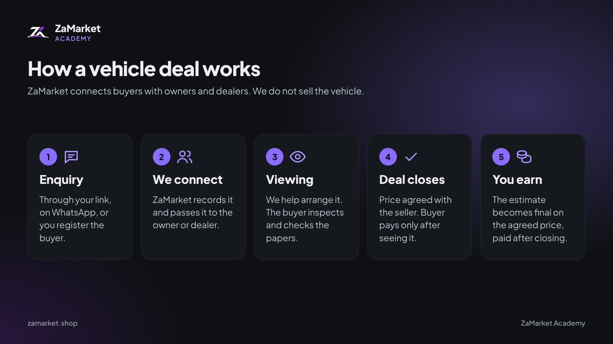

**You will be able to:** Find the vehicle tools and the Promotion studio and know when to use each.

**Lesson**

- Vehicles shows every car you can promote, your estimated reward for each, and My buyers: the people you registered or who came through your link.
- On a vehicle page you have Make a poster to share, Photos (all the photos to post), Copy post, Copy link, WhatsApp, and Register a buyer for someone who contacted you directly.
- The Promotion studio collects ideas for where to find interested buyers and ready-made materials.
- Module 10 covers vehicles in depth.

**Show it:** Open one vehicle. Tap Photos and save all of them, then Copy post. Paste the post into a note to see it.

**Your turn:** Pick one vehicle and write three types of people who might buy it.

**Check:** A friend calls you about a car you posted. Where do you record them so you are credited?

> On the vehicle page, tap Register a buyer and enter their name and number.

*For the trainer:* Point out that registering a buyer is how offline conversations still get credit.

### Lesson 02.05: Getting paid

*About 7 minutes*

**You will be able to:** Request a payout correctly and track it until it is paid.

**Lesson**

- In My earnings, the Getting paid box shows three amounts: ready to request, requested (being paid), and paid to you so far.
- When ready to request is above the minimum payout shown there, tap Ask to be paid, choose Airtel Money, MTN Money, Zamtel Kwacha, bank transfer or cash, and enter your details carefully.
- ZaMarket pays you and marks the request as paid. Your history shows every payout.
- Use details in your own name. Mistakes in a number delay your money.

**Show it:** Show the Getting paid box with an example account. Walk through Ask to be paid without submitting.

**Your turn:** Check that your mobile money number is correct and in your name. Write the minimum payout shown in your account.

**Check:** Your commission is pending. Can you request it?

> Not yet. Only amounts shown as ready to request can be requested, after the order is complete and checked.

*For the trainer:* If a learner's account shows a payout pause, explain it is a security measure after a login change; earnings still add up.

## Module 03: Your link: how credit works

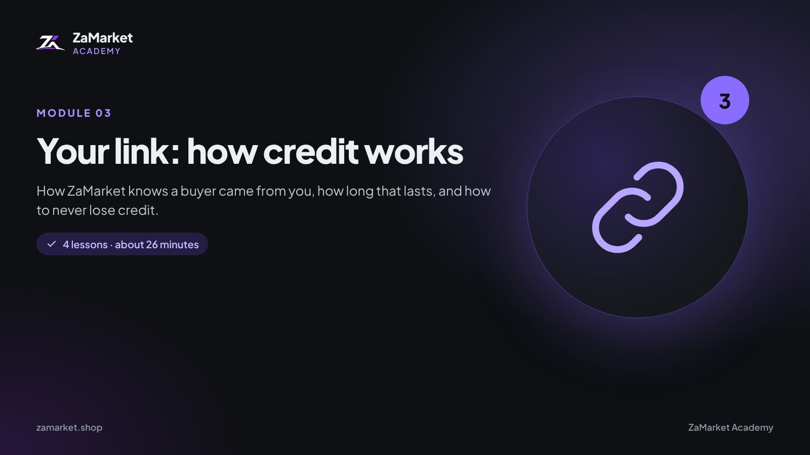

How ZaMarket knows a buyer came from you, how long that lasts, and how to never lose credit.

### Lesson 03.01: How your link credits you

*About 7 minutes*

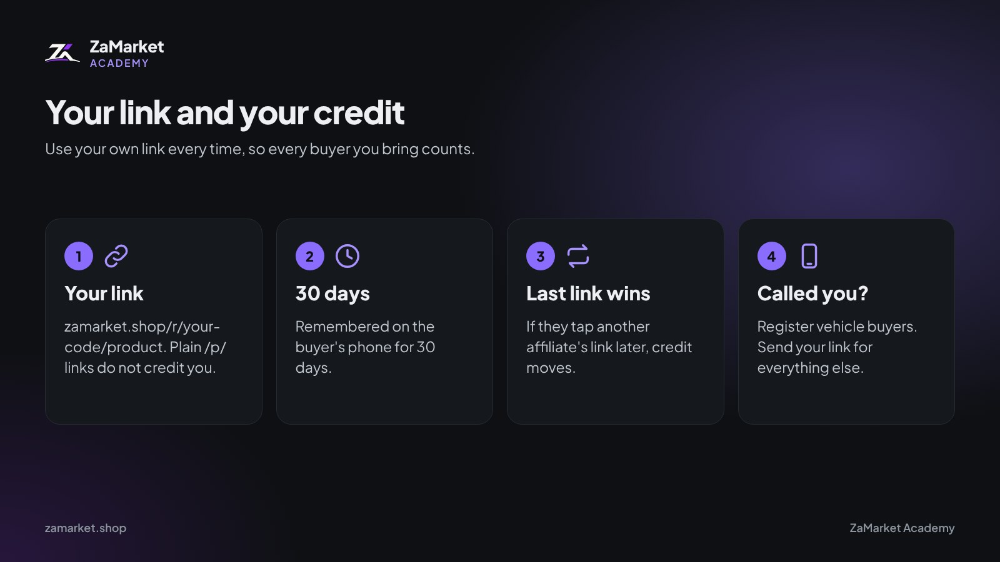

**You will be able to:** Explain what happens when someone taps your link and later orders.

**Lesson**

- When someone opens your link, ZaMarket remembers on their phone that you sent them. If they order, the order is credited to you.
- The memory lasts 30 days. If they come back within 30 days on the same phone and browser and order, you are still credited.
- The last link wins. If within those days they tap another affiliate's link, the credit moves to that link. This is fair: the most recent recommendation helped them decide.
- Credit is per phone and browser. If they open your link on a phone and order from a laptop, the laptop does not know about your link.

**Show it:** Open your link in a private browser window, then browse two other products, then return to the first product. Show that your link is still remembered.

**Your turn:** Explain the 30-day rule and the last-link rule to a friend in your own words.

**Check:** A customer taps your link, then a week later taps another affiliate's link and orders. Who is credited?

> The other affiliate, because the last link wins.

*For the trainer:* Reassure learners: following up within days keeps their link the freshest.

### Lesson 03.02: Never send a plain link

*About 6 minutes*

**You will be able to:** Recognise links that do not credit you and always use your own.

**Lesson**

- A link copied from the browser address bar (zamarket.shop/p/...) does not carry your code. Neither does a screenshot of a product with no link.
- Always use Copy your link, Share poster, or the QR code on your poster.
- If a customer sends you a screenshot asking about a product, reply with your link to that product.
- Posters already carry your link in the QR code and in the caption.

**Show it:** Show two links side by side: one starting zamarket.shop/r/yourcode, one starting zamarket.shop/p/. Ask learners which one pays.

**Your turn:** Go through your last five shares. Were they all your own link? Fix any that were not.

**Check:** Which link credits you: zamarket.shop/p/cake or zamarket.shop/r/ann/cake?

> zamarket.shop/r/ann/cake, the one with your code.

*For the trainer:* This is the most common way new affiliates lose credit.

### Lesson 03.03: Buyers who call or message you directly

*About 7 minutes*

**You will be able to:** Keep credit when a buyer contacts you instead of using your link.

**Lesson**

- For vehicles, tap Register a buyer on the vehicle page and enter their name and phone number. They are credited to you and appear in My buyers.
- For products and lunch plans, send them your link and ask them to order through it, or help them order on their phone through your link while you are with them.
- Do not take orders yourself on paper or collect money. ZaMarket confirms every order with the customer.
- Tell the buyer what happens next: ZaMarket will call to confirm.

**Show it:** Role-play: a buyer calls asking about a pickup. The learner registers them on the vehicle page.

**Your turn:** Practise sending a product link in a reply, with one friendly sentence before it.

**Check:** A buyer you met at church wants the Hilux you posted. How do you make sure you are credited?

> Register them on the Hilux page with Register a buyer, or send them your link to enquire.

*For the trainer:* Remind learners to ask permission before registering someone's number.

### Lesson 03.04: Tagging where you post

*About 6 minutes*

**You will be able to:** Use Posting to so you can see which platform brings buyers.

**Lesson**

- When you make a poster, Posting to adds a small tag to your link: WhatsApp status, WhatsApp chat, Facebook, Instagram, TikTok or printing.
- Nothing about the person is recorded, only where the link was posted.
- After a few weeks, you will see which place works for you. Many affiliates find WhatsApp status brings the most buyers; others do better in Facebook groups. Your numbers decide.
- Use the same tag every time you post to the same place.

**Show it:** Make two posters of the same product, one tagged Facebook, one tagged WhatsApp status. Show that the links differ only by the tag.

**Your turn:** For the next seven days, tag every share. Write down where you posted.

**Check:** Does the tag record who the customer is?

> No. It records only where the link was posted.

*For the trainer:* Link this to Module 13, where learners read their own numbers.

## Module 04: The Promotion Studio: posters, captions and photos

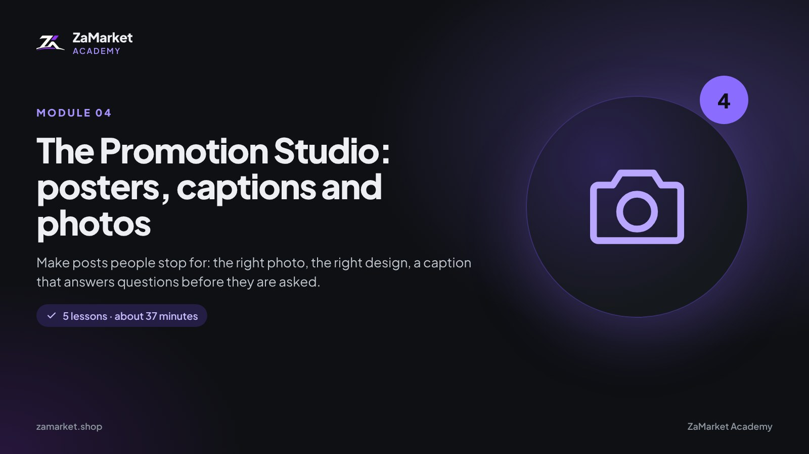

Make posts people stop for: the right photo, the right design, a caption that answers questions before they are asked.

### Lesson 04.01: What makes people stop scrolling

*About 8 minutes*

**You will be able to:** Name the three things a post needs before anyone reads it.

**Lesson**

- People decide in about a second. Three things stop them: a clear photo of the actual thing, a price they can read, and something that tells them it is for them.
- The poster maker takes care of the brand, the price and the QR code. Your job is to choose the best photo and the right design.
- Close, bright, uncluttered photos win. For cakes, the whole cake. For cars, the front three-quarter view. For lunch, the plate from above.
- One product per post. Mixed posts confuse.

**Show it:** Show a strong and a weak photo of the same product side by side. Learners explain why one works.

**Your turn:** For each of your five products, choose the photo you would lead with and write why.

**Check:** Name the three things that make someone stop on a post.

> A clear photo of the actual item, a readable price, and a sign that it is for them.

*For the trainer:* Keep it practical: phone at arm's length, one second, would you stop?

### Lesson 04.02: Choosing the right design

*About 8 minutes*

**You will be able to:** Match each poster design to the product and the place you post it.

**Lesson**

- Full-bleed hero: one great photo filling the poster. Best for cakes, food and cars with a strong main photo.
- Several angles: a large photo with smaller ones beside it. Best for vehicles and items people want to inspect.
- Clean Catalogue: the photo fills the poster, the name at the top, the price at the bottom. Great for status.
- Editorial Split: words on one side, the product on the other. Vehicle posters add year, mileage, gearbox and fuel with icons.
- Use story size for WhatsApp status and TikTok, portrait for Facebook and Instagram feeds.

**Show it:** Make the same vehicle in Several angles and Editorial Split. Discuss which tells the story better.

**Your turn:** Make one poster of each design for different products and post the best one.

**Check:** Which size suits WhatsApp status?

> Story size.

*For the trainer:* Encourage learners to rotate designs so their status does not look repetitive.

### Lesson 04.03: Captions that answer the questions

*About 8 minutes*

**You will be able to:** Write or adapt a caption that answers what, how much, where and what next.

**Lesson**

- Every poster comes with a ready caption from the listing. For vehicles it includes the title, the price as the seller worded it (for example "Slightly negotiable"), the key specifications and up to five standout features.
- A strong caption answers: what is it, how much, where is it or how is it delivered, and what should I do next.
- Add one personal line at the top: who it suits or why you are sharing it. "Perfect for a family that needs space for school runs."
- End with the link and a simple next step: "Tap the link to see all the photos and ask."

**Show it:** Take a generated caption and add one personal line that is true. Read before and after.

**Your turn:** Write personal first lines for your five products.

**Check:** What four questions should a caption answer?

> What it is, how much it costs, where or how it is delivered, and what to do next.

*For the trainer:* Personal lines must stay truthful: "I tasted this" only if they did.

### Lesson 04.04: Photos to post and short videos

*About 8 minutes*

**You will be able to:** Use the listing's photos and make simple videos that sell.

**Lesson**

- On vehicles, Photos lets you save or share all the photos at once. Post them as a set with the caption.
- Short videos outperform still images on TikTok, Reels and status. You can make one from the photos: 5 to 8 photos, 1 second each, the price on the first frame.
- If you can see the product in person (with the seller's permission), a 20-second walk-around is powerful: front, side, inside, dashboard, engine, back.
- Never film people or number plates without permission.

**Show it:** Build a 10-second slideshow from a vehicle's photos in any phone video editor and add the price as text.

**Your turn:** Make one short video for one of your products and post it to status.

**Check:** What should be on the first frame of a short video?

> The product and the price, so viewers know immediately what it is.

*For the trainer:* Keep it simple. The goal is consistency, not cinema.

### Lesson 04.05: When a listing is missing something

*About 5 minutes*

**You will be able to:** Report a thin listing instead of filling the gap yourself.

**Lesson**

- If a product has one blurry photo or no description, do not invent details to make up for it.
- Tell ZaMarket on WhatsApp: which product, and what buyers are asking about. The team asks the seller to improve it.
- Meanwhile promote products with strong listings.

**Show it:** Find one listing that could be better and write the message you would send to ZaMarket.

**Your turn:** Send that message if the listing really needs it.

**Check:** A cake listing does not say how many people it serves. A buyer asks. What do you do?

> Say you will check, ask ZaMarket, and reply with the real answer.

*For the trainer:* Affiliates are the team's eyes on what buyers ask. Their reports improve listings for everyone.

## Module 05: Choosing what to promote and who to

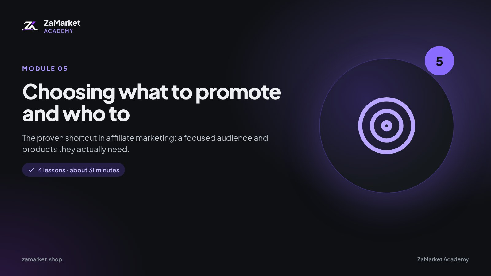

The proven shortcut in affiliate marketing: a focused audience and products they actually need.

### Lesson 05.01: Start with the people you already know

*About 8 minutes*

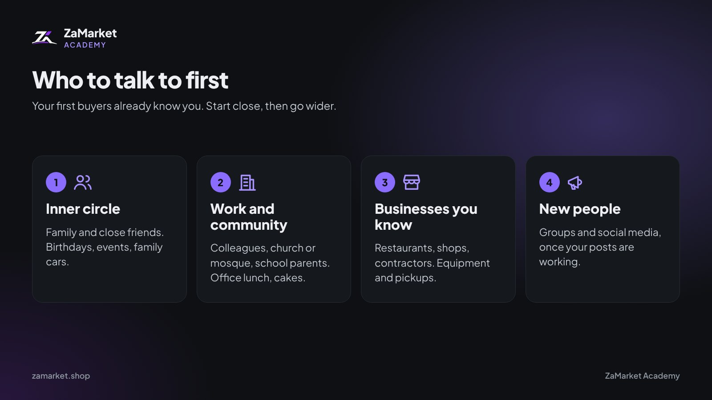

**You will be able to:** Map your warm circle and match people to products.

**Lesson**

- Your first buyers will almost always be people who already know and trust you: family, friends, colleagues, church or mosque community, school parents, neighbours.
- Write a list of 50 people. Next to each, write one thing they might need in the next three months: a birthday cake, lunch at work, a pickup for the business, kitchen equipment for a restaurant.
- You are not selling to them. You are telling them about something useful when it fits their life.
- Your list is private. Never share it.

**Show it:** Draw three rings: inner (family and close friends), middle (colleagues, community), outer (acquaintances). Place 10 example people.

**Your turn:** Write your 50-person list with one likely need for each.

**Check:** Who are usually an affiliate's first buyers?

> People who already know and trust them.

*For the trainer:* Some learners say "I don't know 50 people." Walk them through phone contacts and WhatsApp groups; most do.

### Lesson 05.02: Pick a lane

*About 8 minutes*

**You will be able to:** Choose one main audience and category to be known for.

**Lesson**

- Successful affiliates become the go-to person for something. "Ask Mwila about cakes." "Chanda always knows which cars are available."
- Choose a lane that matches who you know: office workers (lunch plans, cakes for office birthdays), business owners (equipment, pickups), parents (cakes, events), car people (vehicles).
- Post mostly in your lane. Occasionally share something else your audience needs.
- You can change lanes later. Starting focused is what matters.

**Show it:** Show two status feeds: one random, one focused on office lunches and cakes. Which person would you remember?

**Your turn:** Write your lane in one sentence: "I help [people] find [things] on ZaMarket."

**Check:** Why is a focused lane better than posting everything?

> People remember you for one thing and come to you when they need it.

*For the trainer:* Help each learner choose based on their real network, not on what pays most.

### Lesson 05.03: Reading demand: the Zambian calendar

*About 8 minutes*

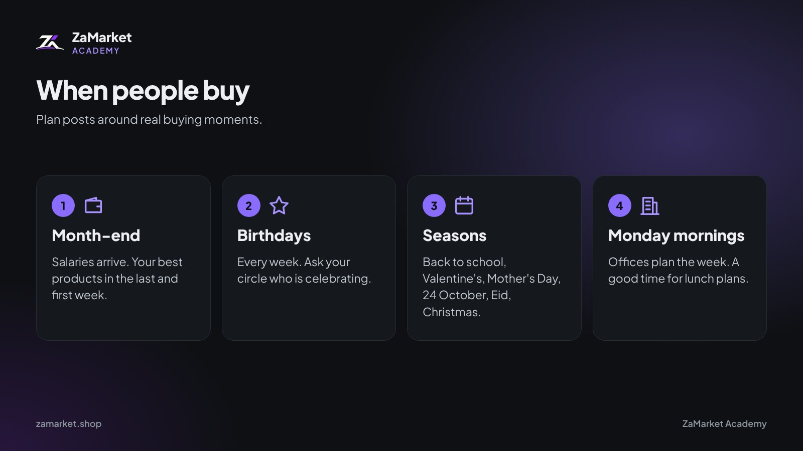

**You will be able to:** Plan posts around the moments people buy.

**Lesson**

- Month-end: salaries arrive, people buy. Post your best products in the last week of the month and the first days of the next.
- Birthdays and celebrations happen every week: cakes are always in demand. Ask your circle about upcoming birthdays.
- Seasons: back to school in January, Valentine's Day, Mother's Day, Independence Day on 24 October, Christmas and New Year. Wedding seasons. Ramadan and Eid for many families.
- Offices: Monday and Tuesday are good days to talk about lunch plans for the week.

**Show it:** Fill a one-month calendar with five buying moments for your lane.

**Your turn:** Plan your posts for the next payday week.

**Check:** When in the month do salaried people usually buy?

> Around month-end and the first days of the new month, after salaries arrive.

*For the trainer:* Don't fake urgency around dates. Real dates are urgency enough.

### Lesson 05.04: Products that pay you again

*About 7 minutes*

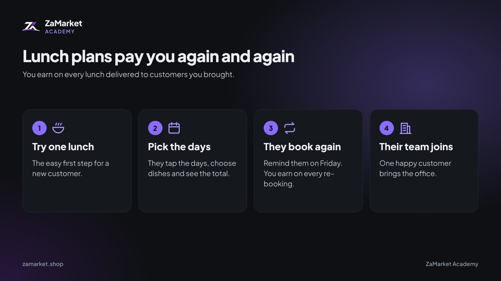

**You will be able to:** Identify listings that bring repeat earnings and prioritise them.

**Lesson**

- Some products are bought once. Others repeat: lunch plans every week, cakes for every birthday, supplies a business reorders.
- A customer who books lunch through you earns you a commission on every lunch delivered, including when they book again.
- One happy office customer can be worth more than ten one-off sales.
- Look after repeat customers: check in after their first week, ask if they want to book the next one.

**Show it:** Compare two customers: one buys one cake, one books lunch five days a week for a month. Count the commissions (using the figures shown in your account).

**Your turn:** List three people who might be repeat customers and what they might repeat.

**Check:** Why are lunch plans valuable for an affiliate?

> You earn on every lunch delivered to customers you brought, including re-bookings.

*For the trainer:* Make the maths concrete with the real figures from the learner's own account.

## Module 06: WhatsApp: status, chats, groups and broadcasts

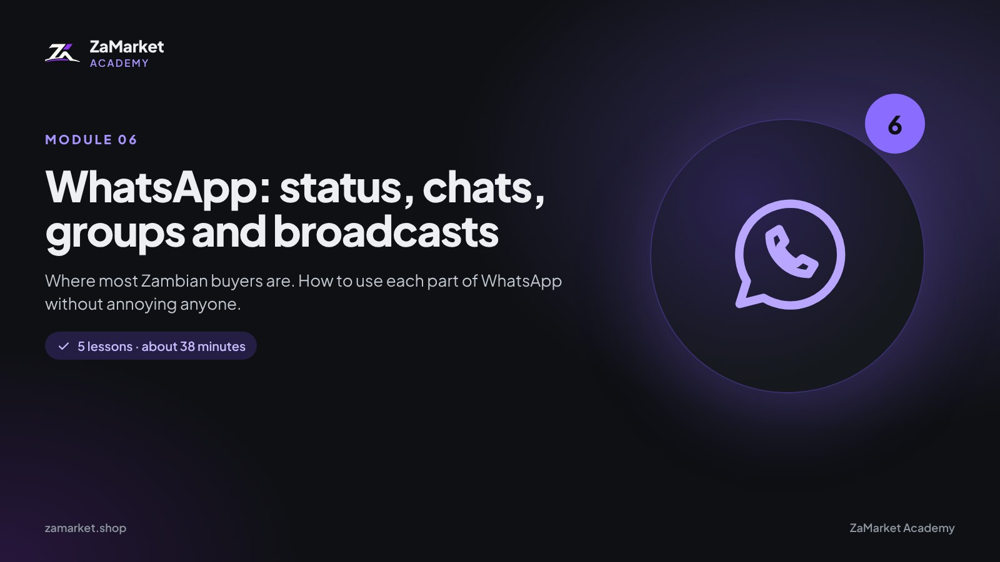

Where most Zambian buyers are. How to use each part of WhatsApp without annoying anyone.

### Lesson 06.01: WhatsApp status: your daily shop window

*About 8 minutes*

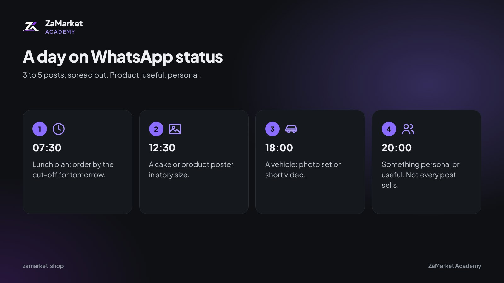

**You will be able to:** Run a daily status routine that brings enquiries.

**Lesson**

- Your status is seen by everyone who saved your number. It is the single most effective free tool most affiliates have.
- Post 3 to 5 status updates a day, spread out: morning, lunchtime, evening. Mix product posters with something personal or useful.
- Use story-size posters tagged WhatsApp status.
- Look at who viewed. People who view your posts often are warm. A friendly message to them about something they might like is welcome, not spam.

**Show it:** Show a day's status plan: 07:30 a lunch-plan poster, 12:30 a cake, 18:00 a vehicle, 20:00 a personal update.

**Your turn:** Post 3 status updates a day for seven days. Note who views most.

**Check:** How many status posts a day is a good rhythm?

> Around 3 to 5, spread across the day.

*For the trainer:* Ask learners to make sure people have their number saved; status only reaches saved contacts.

### Lesson 06.02: One-to-one chats that feel natural

*About 8 minutes*

**You will be able to:** Message a contact about a product in a way that is personal and welcome.

**Lesson**

- Start with them, not the product: "Hi Mutale, how is the new job going?"
- Make it relevant: "You mentioned your daughter's birthday is next week. Rasma Cakery does lovely cakes on ZaMarket, here's the one I'd pick."
- Give one link, not five. Ask one simple question.
- If they are not interested, thank them and move on. Never send the same message twice.

**Show it:** Rewrite a cold message ("Buy this cake!!") into a natural one.

**Your turn:** Send three personal, relevant messages to people on your list.

**Check:** What should the first line of a message be about?

> The person, not the product.

*For the trainer:* Watch for copy-paste messages to many people; that becomes spam.

### Lesson 06.03: Groups: give before you post

*About 8 minutes*

**You will be able to:** Promote in WhatsApp groups without breaking rules or trust.

**Lesson**

- Read each group's rules. Many groups forbid adverts. Respect that, or ask the admin.
- Be a helpful member first: answer questions, share useful information.
- Where selling is allowed, post once, with a clear poster and caption, not every hour.
- Buy-and-sell groups, estate and neighbourhood groups, office groups and car groups are often good places.

**Show it:** List five groups you are in, mark which allow selling and which do not.

**Your turn:** Ask one group admin politely if you may share a lunch plan or product.

**Check:** A group's rules say no adverts. What do you do?

> Do not post adverts there. Ask the admin or simply be helpful in the group.

*For the trainer:* Getting removed from a group damages your name. Rules first.

### Lesson 06.04: Broadcast lists with permission

*About 7 minutes*

**You will be able to:** Build and use a broadcast list of people who asked to hear from you.

**Lesson**

- A broadcast list sends a message to many people as if it were private. Only people who saved your number receive it.
- Only add people who said yes: "I share good deals on ZaMarket once a week. Want me to add you?"
- Send at most once or twice a week, with something genuinely useful.
- Remove anyone who asks, immediately.

**Show it:** Create a broadcast list on WhatsApp called "Weekly picks".

**Your turn:** Ask ten people if they would like to join and add only those who agree.

**Check:** Who should be on your broadcast list?

> Only people who agreed to receive your messages.

*For the trainer:* Permission is what makes broadcasts work long term.

### Lesson 06.05: WhatsApp Business: look professional

*About 7 minutes*

**You will be able to:** Set up WhatsApp Business features that help you sell.

**Lesson**

- The free WhatsApp Business app gives you a profile, a short description, quick replies and labels.
- Profile: your name and "ZaMarket affiliate: cakes, lunch, cars in Lusaka". Do not use the ZaMarket logo as if you were the company.
- Quick replies: save your answers to common questions (how to order, when ZaMarket calls, delivery).
- Labels: New lead, Asked a question, Ordered, Follow up.

**Show it:** Set up three quick replies and four labels.

**Your turn:** Label everyone who has asked you about a product this month.

**Check:** May you use the ZaMarket logo as your profile picture?

> No. Use your own photo and say you are a ZaMarket affiliate.

*For the trainer:* Being clearly an affiliate protects the learner and the brand.

## Module 07: Facebook, TikTok and Instagram

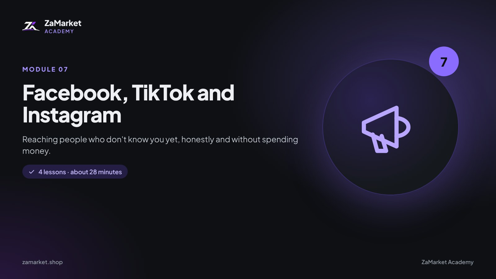

Reaching people who don't know you yet, honestly and without spending money.

### Lesson 07.01: Facebook groups and Marketplace

*About 8 minutes*

**You will be able to:** Post in the right Facebook groups and answer comments quickly.

**Lesson**

- Lusaka has busy buy-and-sell groups, car groups and community groups. Join the ones your lane's buyers are in.
- Post a portrait poster with the caption and your link, following each group's rules.
- Reply to comments and messages fast. The first person to answer usually wins the buyer.
- Tag your link as Facebook so you can compare it with WhatsApp.

**Show it:** Find three groups that fit your lane and read their rules.

**Your turn:** Post one product in one group and reply to every comment within an hour.

**Check:** Why does reply speed matter on Facebook?

> Buyers often ask several sellers; the first helpful answer usually wins.

*For the trainer:* Discourage posting the same thing in twenty groups at once; it looks like spam and gets accounts restricted.

### Lesson 07.02: TikTok and Reels: short videos

*About 8 minutes*

**You will be able to:** Plan and post short videos that people watch to the end.

**Lesson**

- Hook in the first second: the product and the price on screen. "2016 Hilux, K385,000, here's what you get."
- Show, don't tell: photos in sequence, close-ups, the cake being cut (with permission).
- Keep it under 30 seconds. Put the link in your bio and say "link in my bio".
- Post consistently. One video a day for a month beats ten in one day.

**Show it:** Script a 20-second video for one vehicle: hook, three features, price note, call to action.

**Your turn:** Post three short videos this week.

**Check:** What must be in the first second of a short video?

> The product and the price, a reason to keep watching.

*For the trainer:* Don't use copyrighted music in ads; use the platform's own library.

### Lesson 07.03: Instagram for food and cakes

*About 6 minutes*

**You will be able to:** Use Instagram posts and stories for visual products.

**Lesson**

- Instagram works well for cakes, food and lunch plans because people browse with their eyes.
- Post portrait posters to the feed and story posters to stories, tagged Instagram.
- Use local hashtags people actually search: #LusakaCakes, #LusakaFood, #ZambiaBusiness.

**Show it:** Post one cake poster with three local hashtags.

**Your turn:** Post daily stories for a week.

**Check:** Which poster size suits Instagram stories?

> Story size.

*For the trainer:* Hashtags help a little; consistency and good photos matter more.

### Lesson 07.04: Your page as an affiliate

*About 6 minutes*

**You will be able to:** Set up a profile that tells people what you help with.

**Lesson**

- Bio: "I help Lusaka families and offices find great cakes, lunches and cars. ZaMarket affiliate."
- Link in bio: your link to the product or lunch plan you are focusing on this week.
- Pin your best post.
- Be clear you are an affiliate, not ZaMarket itself.

**Show it:** Write your bio for Facebook, TikTok and Instagram.

**Your turn:** Update your bios today.

**Check:** What link should be in your bio?

> Your own affiliate link to what you are promoting this week.

*For the trainer:* Bios with a clear promise attract the right followers.

## Module 08: Writing posts and messages that get replies

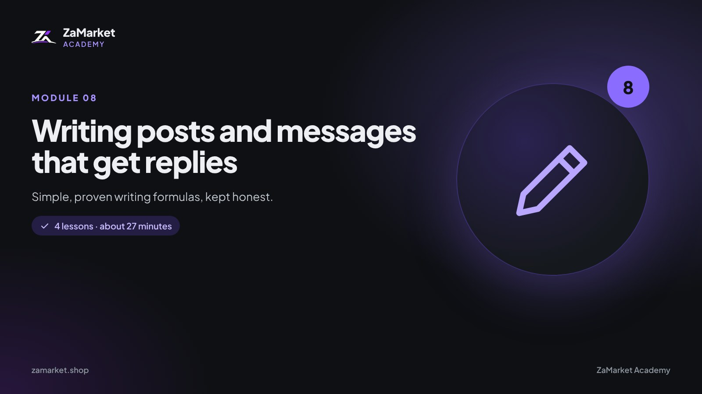

Simple, proven writing formulas, kept honest.

### Lesson 08.01: The PAS formula: problem, answer, step

*About 8 minutes*

**You will be able to:** Write a post using the Problem-Answer-Step formula.

**Lesson**

- Problem: name a real situation. "Tired of spending K80 a day on fast food at work?"
- Answer: the product, with facts from the listing. "Homemade lunch from Rasma Cakery, delivered to your office at lunchtime."
- Step: what to do now. "Order by 18:00 the day before. Try one lunch first: link below."
- Only use problems that are real for your audience and facts that are on the listing.

**Show it:** Write a PAS post for a lunch plan and one for a vehicle.

**Your turn:** Post one PAS post today.

**Check:** What does PAS stand for?

> Problem, Answer, Step.

*For the trainer:* Check every fact in learners' posts against the listing.

### Lesson 08.02: Write for one person

*About 6 minutes*

**You will be able to:** Write posts addressed to one clear reader.

**Lesson**

- "Hi everyone, check this out" speaks to nobody. "If you're planning your son's birthday this month…" speaks to someone.
- Picture one real person on your list while you write.
- Short sentences. One idea per line. Easy to read on a phone.

**Show it:** Rewrite a generic post for one specific reader.

**Your turn:** Write three posts, each for a different person on your list.

**Check:** Why write for one person?

> It feels personal and relevant, so the right people respond.

### Lesson 08.03: Words that build trust

*About 7 minutes*

**You will be able to:** Use specific, checkable details instead of hype.

**Lesson**

- Specific beats exciting: "86,000 km, automatic, service history" beats "amazing car, best deal!"
- Use the seller's words for price: "Negotiable", "Slightly negotiable", or nothing if they said nothing. Never "fixed price" unless the listing says so, and never "negotiable" if it does not.
- Mention what ZaMarket does for the buyer: confirms by phone, arranges delivery, helps arrange vehicle viewings.
- Avoid all caps, many exclamation marks and claims like "cheapest in Zambia".

**Show it:** Underline every specific fact in a post and cross out every vague word.

**Your turn:** Rewrite your last post with three specific facts.

**Check:** A listing says nothing about negotiation. What do you write about the price?

> Just the price. Nothing about negotiation.

### Lesson 08.04: Calls to action that work

*About 6 minutes*

**You will be able to:** End every post with one clear, easy next step.

**Lesson**

- One action only: "Tap the link to see all photos and ask", "Reply LUNCH and I'll send the menu", "Order by 18:00 for tomorrow".
- Make the first step small. Asking a question is easier than buying.
- Real deadlines only: the lunch cut-off is real; "offer ends tonight" is not unless it does.

**Show it:** Write five different calls to action for the same product.

**Your turn:** Test two different calls to action this week and see which gets more replies.

**Check:** Why make the first step small?

> Small steps like asking a question are easy to take, and lead to the sale.

## Module 09: Conversations: answering, objections and follow-up

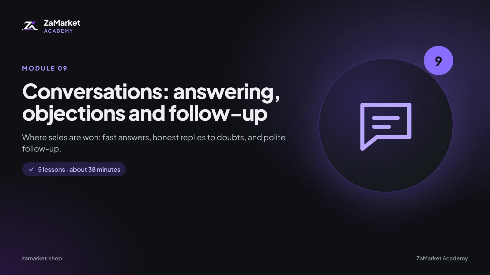

Where sales are won: fast answers, honest replies to doubts, and polite follow-up.

### Lesson 09.01: Answer fast, answer well

*About 7 minutes*

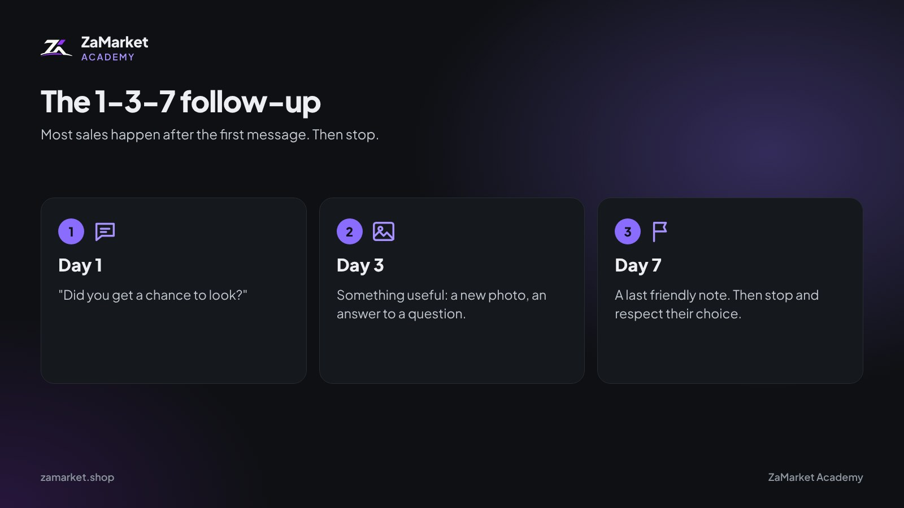

**You will be able to:** Reply to enquiries quickly with the information that moves them forward.

**Lesson**

- Reply within minutes when you can. Interest cools quickly.
- Answer the question asked, then offer the next step: "Yes, it's automatic. Would you like to see it this week? I can ask ZaMarket to arrange a viewing."
- If you don't know, say so and find out: "Good question, let me check and come back to you today." Then do.

**Show it:** Role-play five buyer questions with quick, accurate answers.

**Your turn:** Save quick replies for your top five questions.

**Check:** What do you say when you don't know an answer?

> That you'll check and come back today, then ask ZaMarket and reply.

### Lesson 09.02: Handling "it's too expensive"

*About 8 minutes*

**You will be able to:** Respond to price concerns honestly without discounting.

**Lesson**

- Ask what they are comparing with. Often it is a different product.
- Explain the value from the listing: homemade, delivered, what's included, condition, service history.
- Offer a smaller first step: one trial lunch instead of a week, a smaller cake.
- For vehicles marked negotiable, they can put an offer in their enquiry; ZaMarket passes it to the seller. You never promise a price.

**Show it:** Practise three replies to "too expensive" for a cake, a lunch plan and a car.

**Your turn:** Write your best reply as a quick reply.

**Check:** Can you promise a buyer a lower price on a negotiable car?

> No. They can make an offer in their enquiry and ZaMarket passes it to the seller.

### Lesson 09.03: Other common doubts

*About 8 minutes*

**You will be able to:** Answer trust, timing and payment questions accurately.

**Lesson**

- "Is it safe?" ZaMarket confirms every order by phone; vehicle buyers see the car and papers before paying.
- "When will I get it?" Check the listing: made-to-order items say how long; lunch must be ordered by the cut-off the day before.
- "How do I pay?" ZaMarket confirms with them and explains; for lunch, by mobile money after the confirmation call.
- "Can I see it first?" For vehicles, yes: ZaMarket helps arrange a viewing.

**Show it:** Make a one-page cheat sheet of answers to the ten questions you hear most.

**Your turn:** Keep the cheat sheet on your phone.

**Check:** A vehicle buyer asks when they pay. What is the honest answer?

> Only after seeing the vehicle in person and checking the papers match.

### Lesson 09.04: The follow-up: where most sales happen

*About 8 minutes*

**You will be able to:** Follow up at the right times without pestering.

**Lesson**

- Most people don't buy the first time they see something. A polite follow-up often makes the sale.
- A simple rhythm: after 1 day ("Did you get a chance to look?"), after 3 days (something useful: a new photo or answer), after 7 days (a last friendly note). Then stop.
- Use WhatsApp labels to remember who to follow up.
- Following up within days also keeps your link the most recent one.

**Show it:** Write your 1-3-7 follow-up messages for one product.

**Your turn:** Follow up with everyone who asked you something in the last week.

**Check:** What is a good follow-up rhythm?

> After 1 day, after 3 days with something useful, after 7 days, then stop.

*For the trainer:* Stress "then stop". Respect keeps the relationship.

### Lesson 09.05: After the sale: reviews and referrals

*About 7 minutes*

**You will be able to:** Turn happy customers into reviews and introductions.

**Lesson**

- After delivery, check in: "Did the cake arrive well? How was the party?"
- If they are happy, ask them to leave a review on ZaMarket. Real reviews help everyone.
- Ask for one introduction: "Do you know anyone else at your office who'd like lunch delivered?"
- Never write reviews yourself or ask for fake ones.

**Show it:** Write your after-sale check-in message.

**Your turn:** Check in with your last three customers.

**Check:** May you write a review for a customer?

> No. Only real customers write their own reviews.

## Module 10: ZaMarket Motors: earning from vehicles

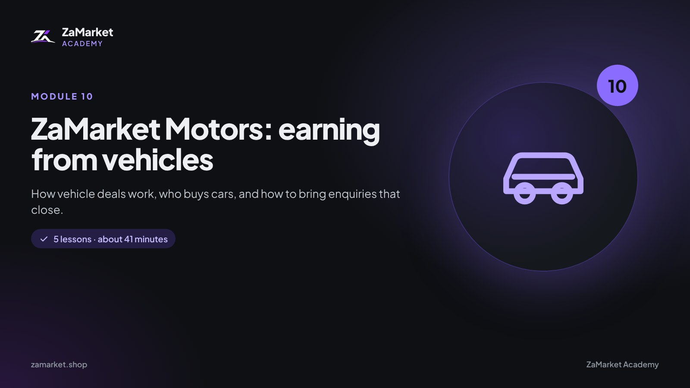

How vehicle deals work, who buys cars, and how to bring enquiries that close.

### Lesson 10.01: How a vehicle deal works

*About 9 minutes*

**You will be able to:** Explain the five steps of a ZaMarket vehicle deal and the affiliate's part in each.

**Lesson**

- ZaMarket does not sell the vehicles. We list cars for owners and dealers we work with and connect buyers with them.
- 1. The buyer enquires (through your link, WhatsApp, or you register them). 2. ZaMarket records the enquiry and passes it to the owner or dealer. 3. ZaMarket helps arrange a viewing, sometimes at a showroom. 4. The buyer inspects and agrees the price with the seller. 5. When the deal closes, ZaMarket earns its fee and you earn your share.
- The reward you see is an estimate at the asking price. If the car sells for less, the final reward is worked out on the price actually paid. It is paid after the deal is closed.
- Your part: find serious buyers, share honest information, register buyers who contact you, and follow up.

**Show it:** Walk through the five steps on the How buying works questions on the Motors page.

**Your turn:** Explain the vehicle process to a friend in under one minute.

**Check:** Your reward for a car shows about K9,600. The car sells for less than the asking price. What happens?

> The final reward is worked out on the price actually paid, and paid after the deal closes.

*For the trainer:* Make sure learners describe the reward as an estimate every time.

### Lesson 10.02: Who buys cars, and where to find them

*About 9 minutes*

**You will be able to:** List buyer types for different vehicles and where to reach them.

**Lesson**

- Pickups and SUVs: small business owners, farmers, contractors, NGOs, families who travel to the village.
- Small cars (Vitz, Fit, Demio): first-time buyers, young professionals, taxi and delivery operators.
- Premium cars: professionals and business owners upgrading.
- Where: your own contacts, car groups on Facebook, colleagues, mechanics and car wash owners (they hear who is looking), people selling their old car (they will need another).

**Show it:** For one listed vehicle, write three buyer types and where you would reach each.

**Your turn:** Tell ten people in your circle you can help them find vehicles, and ask who they know that is looking.

**Check:** Name two places where you might hear about someone looking for a car.

> Mechanics and car wash owners; Facebook car groups; colleagues; people selling their old car.

### Lesson 10.03: Posts that sell vehicles

*About 8 minutes*

**You will be able to:** Share a vehicle with the right poster, photos and caption.

**Lesson**

- Use Several angles or Editorial Split: both show year, mileage, gearbox and fuel. The caption adds up to five standout features from the listing.
- Post the full photo set too (Photos button). Car buyers want to see everything.
- Use the price exactly as the seller worded it.
- A 20-second slideshow video does well on TikTok and status.

**Show it:** Make an Editorial Split poster and a photo set for one vehicle.

**Your turn:** Post one vehicle to your status and one car group this week.

**Check:** Where do the highlighted features in a vehicle caption come from?

> Only from the features recorded on that vehicle's listing.

### Lesson 10.04: Registering buyers and following them

*About 8 minutes*

**You will be able to:** Register a buyer, track them in My buyers and follow up.

**Lesson**

- When someone contacts you directly about a car, tap Register a buyer on that vehicle, enter their name and number with their permission, and add a note (budget, when they want to view).
- My buyers shows everyone credited to you and the status of their deal.
- Follow up after the viewing: "How did the viewing go? Anything you'd like me to ask?"
- Pass every question to ZaMarket; the team speaks with the seller.

**Show it:** Register a test buyer with a practice note (do not submit real data without permission).

**Your turn:** Check My buyers weekly and follow up with each buyer.

**Check:** What must you have before registering someone's number?

> Their permission.

### Lesson 10.05: Being trusted with big purchases

*About 7 minutes*

**You will be able to:** Behave in a way that earns trust on expensive purchases.

**Lesson**

- Never collect deposits or money. Buyers pay only after seeing the car and checking the papers.
- Encourage a mechanic's inspection. ZaMarket passes the request to the seller.
- Never promise the condition beyond what the listing says. "Details come from the seller; confirm anything important at the viewing."
- A buyer who trusts you sends you their friends.

**Show it:** Role-play a buyer asking you to hold the car with a deposit. Respond correctly.

**Your turn:** Add the safe-buying points to your quick replies.

**Check:** A buyer offers you a deposit to reserve a car. What do you do?

> Decline. Explain they pay only after viewing and checking papers, and pass their interest to ZaMarket.

*For the trainer:* This protects learners from fraud accusations.

## Module 11: Lunch at work: earning every day from lunch plans

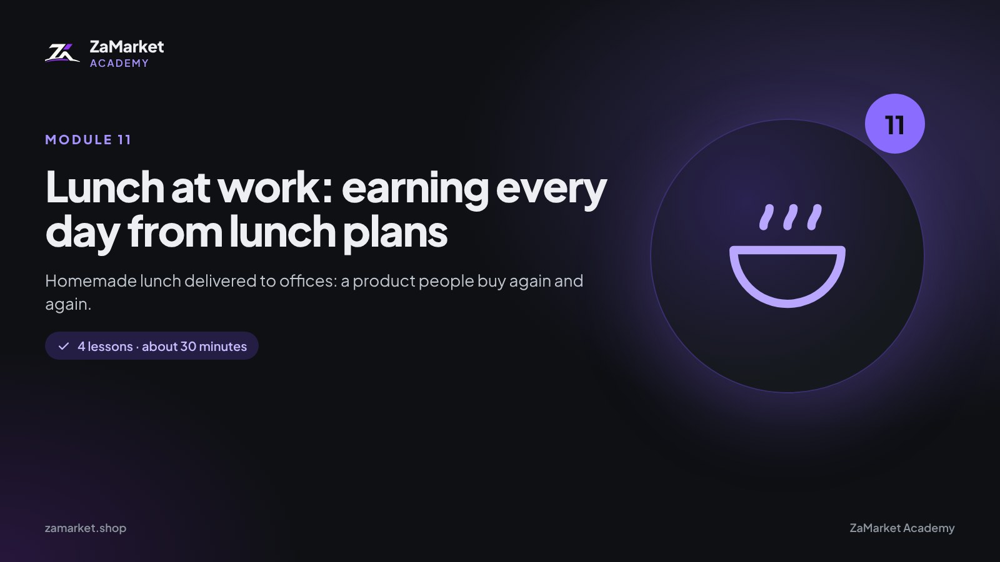

Homemade lunch delivered to offices: a product people buy again and again.

### Lesson 11.01: How lunch plans work

*About 8 minutes*

**You will be able to:** Explain lunch plans to an office worker in under a minute.

**Lesson**

- A seller (for example Rasma Cakery & Pastry) cooks homemade lunches. Customers choose their days and a dish for each, and ZaMarket riders deliver to their workplace at lunchtime.
- Orders close the evening before (the cut-off is shown on the plan, for example 18:00).
- Customers can try one lunch first, book their own days, or order for their team.
- ZaMarket calls to confirm; they pay by mobile money. Where the plan shows the guarantee, a late or wrong lunch is free.

**Show it:** Open a lunch plan in a seller's shop. Tap Whole week, change a day, and watch the total update.

**Your turn:** Explain lunch plans to one office worker you know.

**Check:** When must a customer order for tomorrow?

> By the cut-off shown on the plan, the evening before.

### Lesson 11.02: Offices: your best customers

*About 8 minutes*

**You will be able to:** Find and approach offices for lunch plans.

**Lesson**

- Every office has people who eat lunch at their desk every day. One person who tries it often brings their colleagues.
- Start with your own workplace or a friend's. Offer a trial: "Try one lunch tomorrow and see."
- Team orders: one person orders for several colleagues, delivered together.
- Reception staff and office administrators often organise lunch: be polite and helpful to them.

**Show it:** List five offices where you know someone.

**Your turn:** Get one trial lunch booked through your link this week.

**Check:** What is the easiest first step for a new lunch customer?

> Trying one lunch.

### Lesson 11.03: Sharing the lunch plan

*About 7 minutes*

**You will be able to:** Share lunch plans with posters and messages that convert.

**Lesson**

- Use Make a poster to share on the lunch plan: the cover and dish photos with your link.
- Post in the morning (people think about lunch) and in the afternoon before the cut-off ("order by 18:00 for tomorrow").
- Share the menu days: "Monday chicken stew, Wednesday fish and nshima."

**Show it:** Make a lunch poster and a caption for tomorrow's menu.

**Your turn:** Post lunch twice a day for five working days.

**Check:** Why post lunch in the afternoon?

> To remind people before the cut-off for tomorrow's lunch.

### Lesson 11.04: Keeping lunch customers

*About 7 minutes*

**You will be able to:** Keep customers booking week after week.

**Lesson**

- You earn on every lunch delivered to customers you brought, including re-bookings.
- Check in after the first lunch and the first week.
- Remind them on Thursday or Friday to book next week.
- Pass feedback to ZaMarket: what they loved, what could be better.

**Show it:** Write your Friday "book next week" message.

**Your turn:** Set a weekly reminder to message your lunch customers.

**Check:** Do you earn when a customer you brought books lunch again next month?

> Yes, on every lunch delivered to them.

## Module 12: Honesty, the law and staying paid

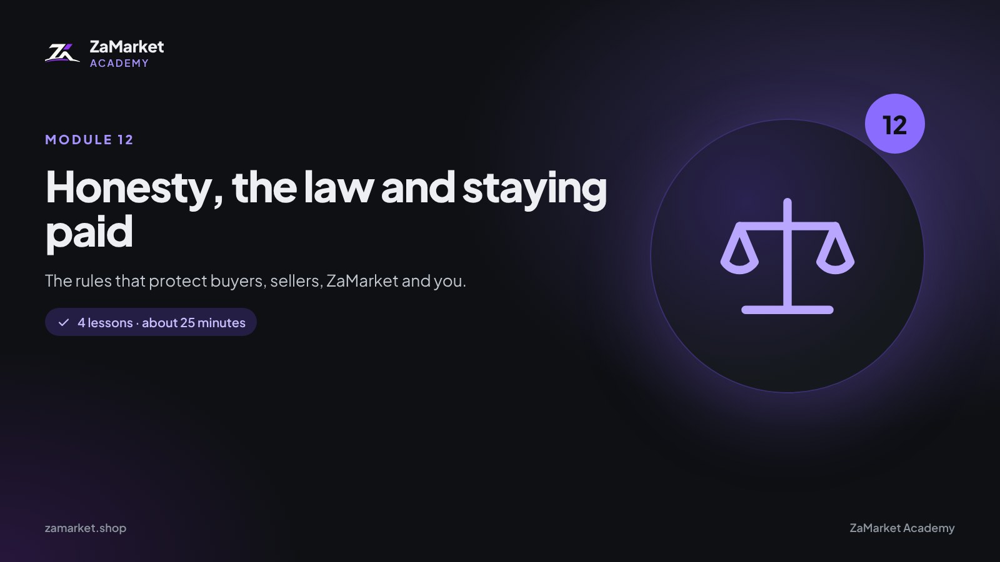

The rules that protect buyers, sellers, ZaMarket and you.

### Lesson 12.01: Disclosure: saying you earn

*About 6 minutes*

**You will be able to:** Disclose your affiliate relationship simply and naturally.

**Lesson**

- Telling people you earn a commission is honest and expected in affiliate marketing worldwide.
- Simple ways: "I'm a ZaMarket affiliate" in your bio; "I earn a small commission if you order through my link" in conversations where it matters.
- Disclosure rarely loses a sale. Hiding it, and being found out, loses trust.

**Show it:** Write your disclosure line for your bio and for chats.

**Your turn:** Add the line to your bios.

**Check:** Does saying you earn commission usually lose sales?

> Rarely. It builds trust; hiding it damages trust.

### Lesson 12.02: Things that get commissions cancelled

*About 7 minutes*

**You will be able to:** Recognise actions that break the rules and cancel commissions.

**Lesson**

- Ordering through your own link for yourself to earn commission, or fake orders.
- Spam: messaging people who did not agree, flooding groups.
- Inventing claims, discounts, reviews or stock levels.
- Pretending to be ZaMarket or a seller.
- ZaMarket checks orders before commission becomes ready. Breaking rules can lead to cancelled commissions and removal from the programme.

**Show it:** Sort ten example actions into allowed and not allowed.

**Your turn:** Review your last week of posts against this list.

**Check:** Can you earn commission on an order you place for yourself through your own link?

> No. Self-orders to earn commission are not allowed.

### Lesson 12.03: Privacy and people's numbers

*About 6 minutes*

**You will be able to:** Handle customers' personal information responsibly.

**Lesson**

- Use a buyer's number only to help them with what they asked about.
- Never share or sell contact lists. Never add people to groups without asking.
- Register a vehicle buyer only with their permission.
- If someone asks you to delete their details, do it.

**Show it:** Check your WhatsApp groups: did you add anyone without asking?

**Your turn:** Ask permission before adding anyone to a broadcast list from now on.

**Check:** Someone asks you to stop messaging them. What do you do?

> Stop immediately and remove them from any lists.

### Lesson 12.04: What halal earning means here

*About 6 minutes*

**You will be able to:** Explain why ZaMarket's affiliate model is fair and lawful.

**Lesson**

- You earn a fee for a real service: connecting a buyer with something they need, honestly described.
- No interest, no gambling, no deception, no hidden charges to the customer from you.
- The customer pays the listed price; your commission comes from ZaMarket's fee, not from overcharging the customer.
- If you are ever unsure whether something is right, ask before you do it.

**Show it:** Discuss: why must the commission never be added secretly to a customer's price?

**Your turn:** Write one sentence explaining to a doubtful friend why this work is honest.

**Check:** Where does your commission come from?

> From ZaMarket's fee on the sale, not from adding to the customer's price.

## Module 13: Your numbers: tracking what works

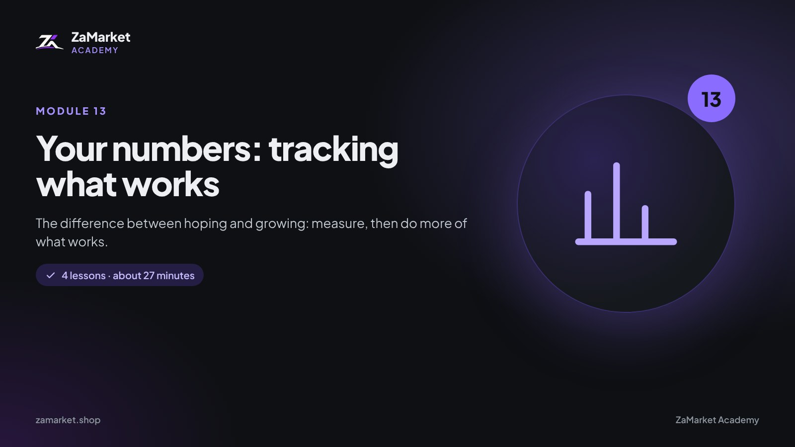

The difference between hoping and growing: measure, then do more of what works.

### Lesson 13.01: The four numbers that matter

*About 8 minutes*

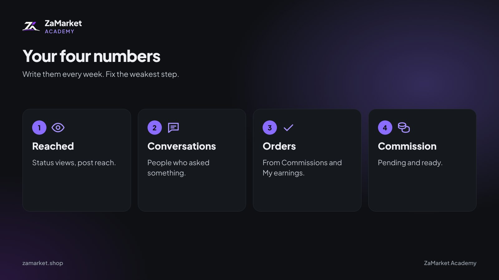

**You will be able to:** Track people reached, conversations, orders and commission.

**Lesson**

- Reached: how many people saw your posts (status views, post reach).
- Conversations: how many asked you something.
- Orders: how many ordered (see My earnings and Commissions).
- Commission: what was earned and what is ready.
- Write these weekly. Patterns appear quickly.

**Show it:** Fill a weekly tracking table with example numbers and find the weakest step.

**Your turn:** Start your own weekly table today.

**Check:** Many people view your posts but few ask questions. Which step needs work?

> The post itself: the photo, offer or call to action.

### Lesson 13.02: Which platform brings buyers

*About 7 minutes*

**You will be able to:** Use your Posting to tags to decide where to focus.

**Lesson**

- Because your links are tagged, ZaMarket can see which platforms your orders came from.
- After a month, compare: where did your buyers come from? Do more there.
- The 80/20 rule: most results usually come from a few places and a few products. Find yours.

**Show it:** Look at a month of example results and choose where to focus.

**Your turn:** After 30 days, write your top platform and top product.

**Check:** What is the 80/20 rule in affiliate work?

> Most results come from a few places and products; focus on them.

### Lesson 13.03: Your monthly goal

*About 6 minutes*

**You will be able to:** Set and track a monthly goal on your dashboard.

**Lesson**

- Your dashboard has a monthly goal. It counts real commission, not product sales.
- Work backwards: goal ÷ average commission per sale = sales needed. Sales needed × conversations per sale = conversations needed.
- Adjust each month based on your real numbers.

**Show it:** Work out how many conversations you need for a sample goal.

**Your turn:** Set this month's goal on your dashboard and work backwards.

**Check:** Does the monthly goal count product sales or your commission?

> Your commission.

### Lesson 13.04: Weekly review: 15 minutes

*About 6 minutes*

**You will be able to:** Run a short weekly review that improves next week.

**Lesson**

- Every Sunday evening: look at your four numbers, your best post, your worst post.
- Decide one thing to keep and one thing to change.
- Plan next week's posts around payday, birthdays and your lane.

**Show it:** Do a practice review with sample numbers.

**Your turn:** Put a weekly 15-minute review in your calendar.

**Check:** What two decisions come out of a weekly review?

> One thing to keep and one thing to change.

## Module 14: The 30-day plan: from first sale to steady income

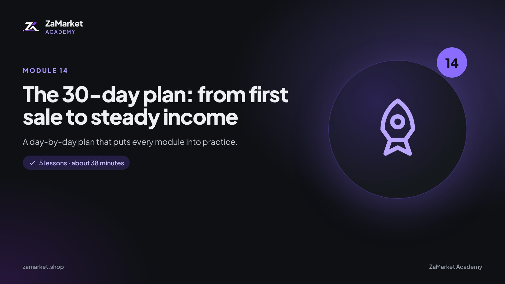

A day-by-day plan that puts every module into practice.

### Lesson 14.01: Week 1: set up and tell your circle

*About 8 minutes*

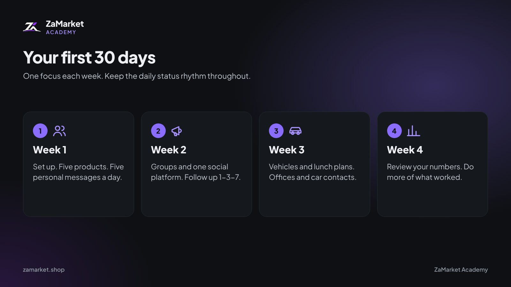

**You will be able to:** Complete setup and start conversations with your warm circle.

**Lesson**

- Day 1: profile, bios, WhatsApp Business, quick replies and labels.
- Day 2: choose your lane and five products. Make posters for each.
- Days 3 to 7: post 3 status updates a day. Message 5 people a day from your list, personally and relevantly.
- Goal: 25 real conversations by the end of week 1.

**Show it:** Show a filled-in week 1 checklist.

**Your turn:** Complete week 1.

**Check:** How many personal conversations should you aim for in week 1?

> About 25 (five a day for five days).

### Lesson 14.02: Week 2: go wider

*About 8 minutes*

**You will be able to:** Add groups and one social platform.

**Lesson**

- Keep the daily status rhythm.
- Join three groups in your lane and contribute before posting.
- Start one platform: Facebook groups or TikTok. Post daily.
- Follow up with everyone from week 1 (1-3-7).

**Show it:** Plan week 2 on one page.

**Your turn:** Complete week 2.

**Check:** Which follow-up rhythm continues in week 2?

> 1-3-7: after one day, three days and seven days.

### Lesson 14.03: Week 3: a big-ticket push

*About 8 minutes*

**You will be able to:** Focus on vehicles and lunch plans, the products with large or repeat rewards.

**Lesson**

- Choose two vehicles and one lunch plan.
- Tell your mechanic, car wash and business contacts you can help them find vehicles.
- Get three offices to try one lunch.
- Register every vehicle buyer who contacts you.

**Show it:** Show sample week 3 posts for a vehicle and a lunch plan.

**Your turn:** Complete week 3.

**Check:** Why focus on vehicles and lunch plans in week 3?

> Vehicles bring large rewards; lunch plans bring repeat earnings.

### Lesson 14.04: Week 4: review and double down

*About 7 minutes*

**You will be able to:** Use your numbers to choose what to repeat next month.

**Lesson**

- Do your weekly review with all four weeks of numbers.
- Find your best platform, product and message.
- Check in with every customer, ask for reviews and one introduction.
- Set next month's goal based on real numbers.

**Show it:** Show an example month-end review.

**Your turn:** Complete your month-end review.

**Check:** What should next month's goal be based on?

> Your real numbers from this month.

### Lesson 14.05: Becoming the go-to person

*About 7 minutes*

**You will be able to:** Build a reputation that brings buyers to you.

**Lesson**

- Be consistent: people buy from those they see every day.
- Be helpful even when there is no sale: answer questions, share useful information.
- Be honest: your name is worth more than any one commission.
- Keep learning: come back to this Academy whenever something stops working.

**Show it:** Share stories of how trust leads to repeat buyers.

**Your turn:** Write your promise to your customers in one sentence and live by it.

**Check:** What matters more than any single commission?

> Your name and the trust people have in you.

*For the trainer:* Close the course warmly and invite learners to share their first-month results.
